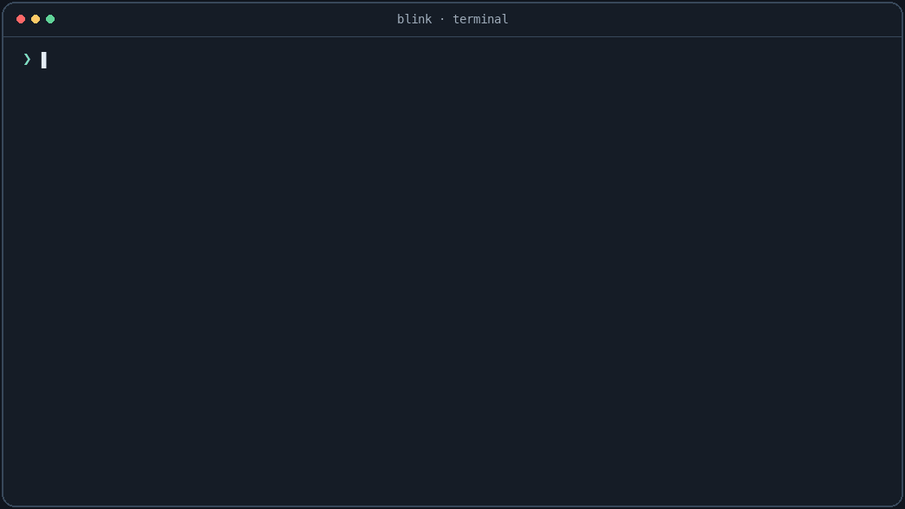

# Blink

Blink revisa la calidad de archivos **CSV, TSV y Parquet** desde la terminal. Analiza tus datos localmente y deja el archivo original intacto.



## Instalación

Requiere **Python 3.11 o superior**. Con [uv](https://docs.astral.sh/uv/getting-started/installation/) instalado, ejecutá:

```bash
uv tool install blink-data-lint
blink --help
```

También podés instalarlo en un entorno virtual con `python -m pip install blink-data-lint`. Si instalaste con uv y la terminal no encuentra `blink`, ejecutá `uv tool update-shell` y abrí una terminal nueva.

## Uso

```bash
blink datos.csv
```

Reemplazá `datos.csv` por la ruta de tu archivo. Si tiene espacios, escribila entre comillas: `blink "mis datos/ventas.csv"`.

El informe muestra cuántas filas y columnas hay y qué conviene revisar. Señala valores faltantes, filas duplicadas, columnas constantes, valores atípicos y tipos inconsistentes. Los avisos incluyen ejemplos para ubicar el problema. Los registros se cuentan desde 1, sin incluir la cabecera.

| Si querés… | Ejecutá |
| --- | --- |
| Leer números como `12,50` en un CSV o TSV sin separadores de miles | `blink ventas.csv --decimal-comma` |
| Comparar con una versión anterior del archivo | `blink datos.csv --baseline anterior.csv` |
| Explorar anomalías con Isolation Forest | `blink datos.csv --ml` |
| Exportar el informe a JSON | `blink datos.csv --json > informe.json` |
| Consultar todas las opciones | `blink --help` |

Licencia [MIT](LICENSE).
